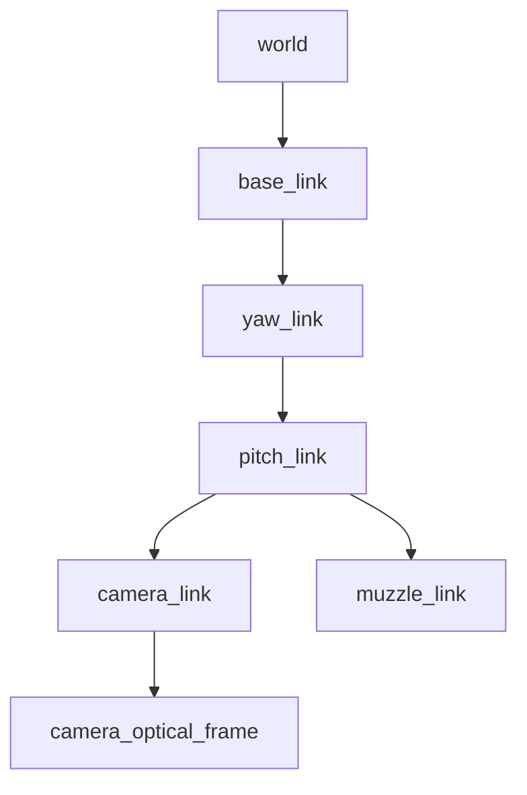

# RM Auto Aim MuJoCo Simulator

当前完整开发版本位于 [`feat/rmuc-armor-lab`](https://github.com/LC-RoboMaster/RM_auto_aim_sim/tree/feat/rmuc-armor-lab)
分支，包含已合入的 HDR Shader、异步相机和性能面板；`main` 暂时仍是初始版本。

**[参数配置与 UI 对照](src/rm_auto_aim_sim/docs/CONFIGURATION.md)**：
`src/rm_auto_aim_sim/config/sim.yaml` 已集中列出全部参数并逐项添加中文注释。
相机光照在第 3 组；UI 修改只影响当前运行，不自动写回 YAML。

## v0.2：RMUC 场地、旋转装甲目标与测试面板

新增四板靶标（r1/r2、h1/h2、XYZ、15° 上倾、红蓝切换、可调正反转）、
命中统计和曲线、深色简洁 UI、自定义 fx/fy/cx/cy 与环境亮度。

**[新功能完整使用说明](src/rm_auto_aim_sim/docs/ARMOR_LAB.md)**。
默认配置启动带用户装甲模型的轻量调试场地；实际 RMUC 场地由上游场地包导入，
使用导入脚本生成的 `sim_rmuc.yaml` 启动。未随仓库分发官方派生场地资产。

旧版指南仍可参考，下列旧静态红蓝靶标只保留在 `scenes/arena.xml` 回归场景中。
新的默认场景是 `scenes/lab.xml`，参数和界面变更以上方 v0.2 指南为准。

# RoboMaster 自瞄视觉仿真器（MuJoCo + ROS2 Humble）

这是一个独立的 C++17 工程，参考 [RM_Dron_mujoco_sim](https://github.com/Spaaaace-yyj/RM_Dron_mujoco_sim) 的官方 viewer 集成方式，面向 Ubuntu 22.04、Conda/pip MuJoCo 3.3.7、ROS2 Humble。第一版提供二轴云台、手动/自动模式、RGB 相机、完整 TF 和物理弹丸。后续可以在场景中加入旋转装甲板。

## 已实现

- 保留官方 `simulate` 的观察、暂停、物理/可视化菜单，右侧增加 `Auto Aim` 菜单。
- 手动平移云台底座、控制 pitch/yaw；切换自由观察相机和云台相机。
- 自动模式订阅两个 `std_msgs/msg/Float64` 绝对角度命令；单位为**弧度**。
- 独立 OpenGL 相机线程，默认 **640×480 / 120 FPS / RGB8**；配置支持 100、120、150 FPS。
- 发布同时间戳的 Image/CameraInfo、完整 TF、pitch/yaw、JointState 和 `/clock`。
- 自动 Bool 连射和手动第一人称左键按住连射，共用发射调度器，默认 **15 Hz**。
- 默认弹丸**直径 17 mm、速度 22 m/s、质量 3.2 g**，绿色自发光材质，重力和接触由 MuJoCo 求解。
- 固定 128 槽对象池：默认飞行寿命 8 秒，首次碰撞后 2 秒回收；槽耗尽时跳过该发射，不扩容。
- 提供发射计数、首次接触事件、实际相机 FPS，以及物理测试和 ROS 接口检查脚本。

相机参数是请求采集率，实际帧率取决于 GPU、分辨率、场景复杂度和 DDS 传输。默认不读取深度、不做灰度转换，离屏 MSAA 为 0；渲染在独立线程，不受 viewer 的 60 Hz 垂直同步限制。请使用检查脚本确认你电脑上是否达到 100–150 FPS。


## 1. 安装依赖

假设已经安装 ROS2 Humble：

```bash
sudo apt update
sudo apt install -y build-essential cmake ninja-build libglfw3-dev libyaml-cpp-dev \
  libgl1-mesa-dev libegl1-mesa-dev python3-colcon-common-extensions \
  ros-humble-rclcpp ros-humble-rclpy ros-humble-sensor-msgs \
  ros-humble-geometry-msgs ros-humble-rosgraph-msgs ros-humble-std-msgs \
  ros-humble-tf2-msgs ros-humble-tf2-ros ros-humble-rqt-image-view

conda create -n rm_auto_aim_sim python=3.10 -y
conda activate rm_auto_aim_sim
python -m pip install mujoco==3.3.7
source /opt/ros/humble/setup.bash
```

也可以使用现有 Conda 环境，但 MuJoCo 必须是 3.3.7，避免官方 viewer 源码与动态库接口不匹配。CMake 自动定位 pip 安装的头文件和库，不硬编码你的用户名或 Conda 路径。

## 2. 编译、启动

解压后进入 `RM_AutoAim_Mujoco_Sim` 根目录：

```bash
conda activate rm_auto_aim_sim
source /opt/ros/humble/setup.bash
bash build.sh
source install/setup.bash
ros2 launch rm_auto_aim_sim sim.launch.py
```

构建脚本把“读取 MuJoCo 的 Python”和“ament/colcon 的系统 Python”分开，避免 Conda 与 ROS2 的 Python 扩展混用。测试失败时脚本会停止。也可以直接构建：

```bash
/usr/bin/python3 -m colcon build --symlink-install --packages-select rm_auto_aim_sim \
  --cmake-args -DCMAKE_BUILD_TYPE=Release \
  -DCONDA_PYTHON="$CONDA_PREFIX/bin/python" \
  -DPython3_EXECUTABLE=/usr/bin/python3 -DPYTHON_EXECUTABLE=/usr/bin/python3
```

自定义配置文件：

```bash
ros2 launch rm_auto_aim_sim sim.launch.py \
  config:=/绝对路径/sim.yaml
```

配置位于 `src/rm_auto_aim_sim/config/sim.yaml`。`scene_path` 相对**配置文件所在目录**解析；复制配置到其他目录时，要同步修改路径。全部配置是启动参数，修改后重启。ROS 参数覆盖可以通过：

```bash
ros2 run rm_auto_aim_sim rm_auto_aim_sim \
  --config "$PWD/src/rm_auto_aim_sim/config/sim.yaml" \
  --ros-args -p camera_fps:=150.0 -p initial_mode:=auto
```

## 3. 手动操作

### 相机画质和性能

`config/sim.yaml` 默认启用相机 Shader。右侧 **CAMERA / LIGHT** 可实时切换
`Shader camera` 和 `Shadows`，并调整曝光、Bloom 和灯条强度；关闭 Shader 时输出
MuJoCo 原生画面，方便在同一场景比较。灯条局部照明采用深度重建和 GGX
高光，发光部分进入 RGBA16F 缓冲，Bloom 在四分之一分辨率处理，最后固定曝光
并转换成 RGB8。场景纹理和基础环境光仍由 MuJoCo 绘制。

默认相机外观面向漫水二值化：`Black sky` 开启，`Floor / scene color` 为 0，
`Scene light` 为 0.03，使天空、地面及障碍物接近黑色；灯条白色混合为 0.65，
HDR 亮度为 8，光晕强度为 0.9。右侧滑条可分别调背景亮度、灯条灰度、
灯条发光和光晕；`Exposure` 会改变整张图像。点击 `Restore YAML look` 可恢复
`config/sim.yaml` 中的外观参数。Shader 作用于 `/image_raw`；3D viewer 的
`Gimbal` 视角仍是 MuJoCo 原生预览，查看算法输入请打开图像话题。

右侧 **PERFORMANCE** 显示实测相机 FPS、采集到发布延迟、各 CPU 提交阶段
耗时、进程 CPU/RSS 和估算的相机缓冲区大小。CPU 100% 表示占满一个逻辑核；
`GPU render` 是显卡计时查询的场景和 Shader 绘制时间，`GPU transfer` 是显卡写入
PBO 的时间，`PBO map/copy` 是 CPU 取回缓冲的时间；`Render submit` 是 CPU
提交耗时。打开 `Show perf plots` 可查看最近
15 秒的阶段耗时和进程负载。异步 PBO 队列最多 3 帧，忙时丢弃新采集，防止
图像越积越旧；消息保留各自采集时刻的仿真时间、内参和位姿。
暂停后仍会收完已提交的 GPU 图像，队列收空后不重复采集同一仿真时刻；FPS
随后归零，CPU/RSS 继续更新。检测到重置或历史回退导致采集时间倒退时，先丢弃
队列中的旧图像，再提交新时间线的图像；这些丢弃也计入 `Dropped`。

在相同配置、场景和显卡上，分别切换两种模式并记录 FPS 与延迟，才能判断
该设备上的性能差异。无显示器时可运行
`MUJOCO_GL=egl python src/rm_auto_aim_sim/tests/run_render_test.py --library build/libaim_render_probe.so`。

右侧 `Auto Aim` 菜单的 `Control mode` 选择 `MANUAL`，`View` 选择 `Gimbal`。原生 Rendering 菜单也能选 `gimbal_camera`，`Esc` 返回自由相机。

| 操作 | 效果 |
|---|---|
| W / S | 沿当前 yaw 的水平朝向前进 / 后退 |
| A / D | 水平向左 / 向右移动 |
| E / Q | 升高 / 降低底座 |
| ↑ / ↓ | 抬头 / 低头 |
| ← / → | yaw 向左 / 向右 |
| 第一人称，按住右键拖动 | 改变云台瞄准角度 |
| 第一人称，按住左键 | 按固定频率连续发射；松开停止 |
| F | 切换自由相机 / 云台相机 |
| 空格 | 暂停 / 继续物理仿真 |
| 自由相机鼠标操作 | 保留官方 viewer 的旋转、平移、缩放逻辑 |

键盘控制要求窗口有焦点、鼠标位于三维画面内；点击菜单不会触发射击。手动模式忽略 ROS 控制命令。自动模式通过 ROS 控制角度和开火，底座保持当前位置。切换模式时保持当前姿态并清除旧控制/连射命令；切入自动模式后重新发送命令。

## 4. ROS2 接口

| 方向 | 默认话题 | 类型 | 约定 |
|---|---|---|---|
| 发布 | `/camera/image_raw` | `sensor_msgs/msg/Image` | `rgb8`，光学坐标系，仿真时间 |
| 发布 | `/camera/camera_info` | `sensor_msgs/msg/CameraInfo` | 与 RGB 同 stamp，理想针孔模型，畸变为 0 |
| 发布 | `/gimbal/pitch` | `std_msgs/msg/Float64` | 当前 pitch，rad，抬头为正 |
| 发布 | `/gimbal/yaw` | `std_msgs/msg/Float64` | 当前 yaw，rad，向左为正 |
| 发布 | `/joint_states` | `sensor_msgs/msg/JointState` | yaw/pitch 角度和理想伺服实际角速度 |
| 发布 | `/tf`、`/tf_static` | `tf2_msgs/msg/TFMessage` | 动态/固定变换 |
| 发布 | `/clock` | `rosgraph_msgs/msg/Clock` | MuJoCo 仿真时间 |
| 发布 | `/sim/shot_count` | `std_msgs/msg/UInt64` | 累计成功发射数；reset 后归零 |
| 发布 | `/sim/projectile_hit` | `std_msgs/msg/String` | 每颗弹丸首次接触 JSON；尚不是装甲板命中判定 |
| 发布 | `/sim/camera_fps` | `std_msgs/msg/Float64` | 相机最近两秒的实际墙钟采集 FPS |
| 订阅 | `/gimbal/target_pitch` | `std_msgs/msg/Float64` | pitch **绝对目标角度**，rad |
| 订阅 | `/gimbal/target_yaw` | `std_msgs/msg/Float64` | yaw **绝对目标角度**，rad |
| 订阅 | `/gimbal/fire` | `std_msgs/msg/Bool` | true 持续连射，false 停止 |

RGB 和 CameraInfo 使用 **SensorDataQoS / best effort / depth=2**，订阅端使用 `rclcpp::SensorDataQoS()` 或 `qos_profile_sensor_data`。命令使用 reliable / volatile / depth=1。角度、JointState、动态 TF 使用 reliable；固定 TF 使用 reliable + transient local。所有话题名（包括 TF 与 clock）都能通过 YAML 配置。

默认 true 是**保持型命令**：只发一次 true 就一直连射到 false、模式切换或 reset。`fire_command_timeout: 0.0` 表示不超时；设为如 0.5 后，需要持续更新火控命令。角度命令同样保持，`angle_command_timeout` 可选；超时后在当前位置停止追踪。非有限角度被忽略，超限角度被限幅。默认 yaw 范围 ±π，不做跨 ±π 的最短路径绕回；pitch 范围 −30°～45°，伺服限速 8 rad/s。

示例（先在菜单切到 `AUTO (ROS2)`，或配置 `initial_mode: "auto"`）：

```bash
ros2 topic pub --once /gimbal/target_pitch std_msgs/msg/Float64 '{data: 0.15}'
ros2 topic pub --once /gimbal/target_yaw std_msgs/msg/Float64 '{data: 0.4}'
ros2 topic pub --once /gimbal/fire std_msgs/msg/Bool '{data: true}'
ros2 topic pub --once /gimbal/fire std_msgs/msg/Bool '{data: false}'
```

演示控制和查看图像：

```bash
ros2 run rm_auto_aim_sim auto_control_demo.py --fire
ros2 run rqt_image_view rqt_image_view
ros2 run rm_auto_aim_sim check_ros.py --seconds 10 --min-fps 100
ros2 run tf2_ros tf2_echo world camera_optical_frame
```

演示脚本 Ctrl+C 后会尝试发送 false；需要断连自动停止时，请设置 `fire_command_timeout`。若你在算法节点使用 TF 查询，设置 `use_sim_time:=true`，并使用图像 header stamp 查询 TF。TF 按 `state_hz` 发布，图像从相同锁保护的物理状态取得；相机外参为静态变换，动态轴由 TF 插值。首次图像可能早于足够的 TF 缓存建立，可先等待 TF。暂停时不重复发布同时间戳的新图像。

## 5. 坐标与相机

TF 树：



`world/base_link/camera_link` 采用 x 前、y 左、z 上；默认 yaw 绕 +z，pitch 绕 −y，因此正 pitch 抬头。`camera_optical_frame` 是 OpenCV/ROS 标准：x 右、y 下、z 前。MuJoCo 相机朝自身 −z 看，代码明确转换了这两套坐标，不把相机本体直接冒充 optical frame。

默认内参由垂直视场角计算：`fx=fy=height/(2*tan(fovy/2))`，`cx=(width−1)/2`、`cy=(height−1)/2`。传感器图像没有 viewer 的菜单或调试叠加。枪口与相机有真实位置偏移，弹丸沿 `muzzle_link` 的 +x 发射；以相机目标方向直接发射不包含自动视差/弹道补偿，需要算法自行处理。

## 6. 性能与扩展

相机先复制物理状态再释放锁，GPU 渲染和 DDS 发布均在物理锁外执行。相机持有自己的 mjModel/mjData、mjvScene 和离屏 framebuffer；复用读回缓冲，落后时跳过采集而不累计延迟。实际采样时刻落在物理步上，帧间仿真时间可能略有离散。

物理默认步长 0.5 ms，22 m/s 每步移动 11 mm，小于弹丸直径。MuJoCo 接触仍是离散检测；未来加入很薄、高速移动的靶标时，需要减小步长或增加扫掠检测，不能直接把当前首次接触事件当成最终比赛命中结果。

弹丸有重力、碰撞和摩擦；当前无空气阻力、自旋、散布和云台后坐力。自发光 material emission 提升弹丸自身亮度，标准 MuJoCo renderer 没有 bloom，也不会让弹丸真实照亮环境。云台采用理想位置伺服和运动学底座，尚不模拟电机电流、力矩和底盘接触。

模型拆在 `scenes/arena.xml` 和 `scenes/gimbal.xml`，模型名称独立于 TF 名称，通过 YAML 绑定。URDF 转换和替换方法见 [MODELS.md](src/rm_auto_aim_sim/docs/MODELS.md)。架构、线程和模块见 [ARCHITECTURE.md](src/rm_auto_aim_sim/docs/ARCHITECTURE.md)。场景替换在启动时进行，拖放新模型会提示重启，避免两套模型快照失效。原生 joint slider/ctrl 不是云台控制接口，下一物理步会由控制模块更新云台角度。

## 7. 验证与独立运行

无需 ROS2 的本地查看版本：

```bash
conda activate rm_auto_aim_sim
bash build.sh --standalone
bash run_standalone.sh
```

独立版不发布或订阅 ROS2，仍能手动操作、显示相机视角和发射弹丸。物理测试覆盖角度跟踪/限幅、坐标轴、平移、模式隔离、22 m/s 重力弹道、碰撞、连射频率、停止、寿命和对象池复用。

可选离屏渲染检查（Linux EGL 驱动可用时）：

```bash
MUJOCO_GL=egl python src/rm_auto_aim_sim/tests/run_render_test.py \
  --library build/standalone/libaim_render_probe.so \
  --config src/rm_auto_aim_sim/tests/test_config.yaml --output /tmp/camera_test.ppm
```

当前交付验证范围见 [TEST_RESULTS.md](TEST_RESULTS.md)。ROS2/你的 RTX 4060 实测帧率需要在 Ubuntu 22.04 目标机运行检查脚本。

## 许可

工程使用 Apache-2.0；第三方官方 viewer、lodepng 来源和修改见 [THIRD_PARTY.md](THIRD_PARTY.md)。
