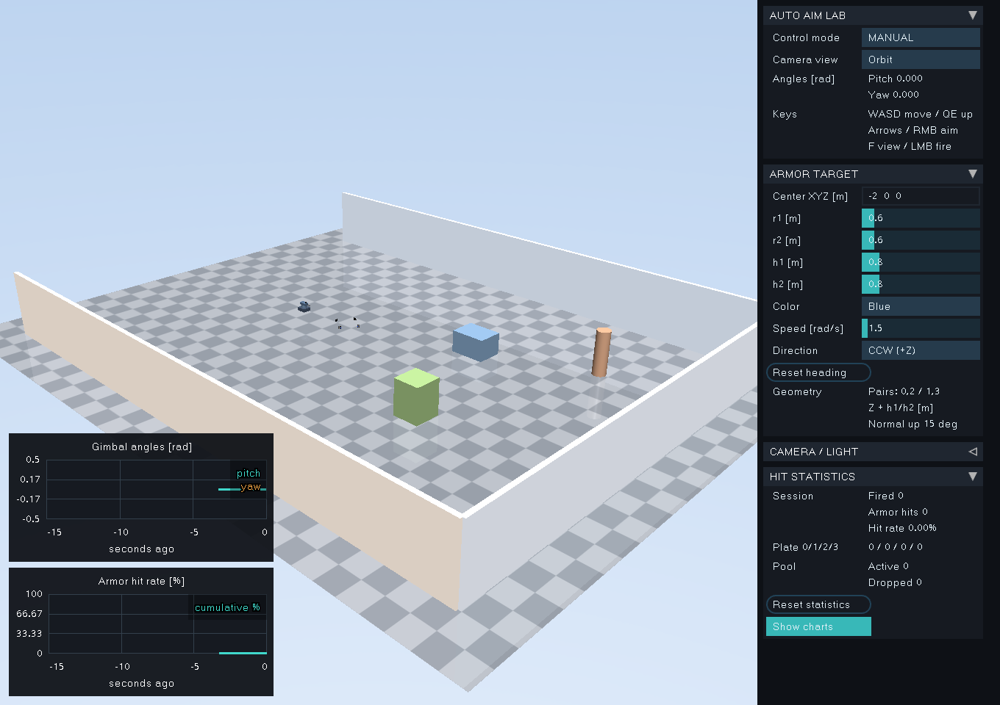

# RMUC 场地与旋转装甲靶标（v0.2）

默认启动的是带真实装甲板外观的轻量调试场景。RMUC 场地使用上游
`ling37luo/rmuc2026-mujoco` 本地生成的场地包；导入后通过生成的配置启动，
原来调试场景的地板、墙和障碍物不会混入 RMUC 场地。



## 1. 使用已有 RMUC 场地包

在 MuJoCo 3.3.7 的 Conda 环境中安装上游的运行包。此版本按上游提交
`3db8efe6ebd478c1a6da42aaa4e2323c26129b8a` 的接口实现并测试：

```bash
conda activate mujoco
python -m pip install -e /path/to/rmuc2026-mujoco
cd /path/to/RM_auto_aim_sim
python src/rm_auto_aim_sim/scripts/import_rmuc_field.py \
  /path/to/local-rmuc2026-field assets/rmuc --profile full

source /opt/ros/humble/setup.bash
bash build.sh
source install/setup.bash
ros2 launch rm_auto_aim_sim sim.launch.py \
  config:="$(pwd)/assets/rmuc/sim_rmuc.yaml"
```

`assets/rmuc` 必须是新目录；脚本不会覆盖已有导出。输出 XML 引用原场地包
中的绝对资产路径，因而**不要删除或移动原场地包**。移动后重新导入至新目录。
只加载场地不需要安装 CAD 转换工具；已有包也无需重新下载官方 STEP。

没有场地包时，先按上游 README 执行 `rmuc2026-field setup`（约 1.25 GB 官方
STEP 下载，转换需额外磁盘空间），再执行上述导入。官方源文件和派生场地资产
按上游要求保持本地使用，不进入本仓库。`full` 保留 CAD 视觉和碰撞；
`collision_only` 仅用于调试物理，不适合视觉算法识别。

导入脚本调用上游 `FieldAsset.open(..., verify=True)` 和 `load_model`，记录原
manifest 的哈希，再导出 `.xml.heights` 浮点边车文件。C++ 在编译场景后注入原
高度样本，避免仅加载 XML 时使用 PNG 量化碰撞高度。不要单独复制 `field.xml`
而遗漏 `.heights`。`source.json` 保存来源与导出哈希，便于追溯。

场地坐标完全沿用上游，Z 向上；云台仍是可平移的测试夹具，不是底盘动力学。
目标默认中心为 `(5,0,0)`，云台默认为 `(-5,0,0.65)`。应按照实际地形在目标 UI
调整 XYZ/h1/h2，用 WASD/QE 调整云台，避免放进建筑或地下。上游碰撞主要是单值
heightfield：遮挡用 CAD 外观，跨层、桥下、悬挑结构的子弹碰撞不能据此认定准确；
可在上游增加其支持的墙面碰撞后再导入。当前不提供官方全场碰撞精度的保证。

## 2. 四块装甲板

此版使用上传模型中的小装甲板、灯条和数字 2 贴图；网格保持原尺寸。
四块板以 0/90/180/270 度排列，朝向环外。

| 参数 | 默认值 | 含义 |
| --- | --- | --- |
| `target_x/y/z` | 5 / 0 / 0 m | 旋转轴在世界中的位置 |
| `target_r1` | 0.6 m | 0、2 号板中心到旋转轴的水平距离 |
| `target_r2` | 0.6 m | 1、3 号板中心到旋转轴的水平距离 |
| `target_h1` | 0.8 m | 0、2 号板中心相对轴原点的高度 |
| `target_h2` | 0.8 m | 1、3 号板中心相对轴原点的高度 |
| `target_tilt_deg` | 15° | 板面外法线向天空抬高的角度 |
| `target_angular_speed` | 0 rad/s | 有符号速度：+ 为从 +Z 往下看的逆时针 |
| `target_initial_angle` | 0 rad | 启动方位 |
| `target_color` | red | red / blue |

板中心世界高度为 `target_z + h1/h2`。r1≠r2 时四点形成椭圆的四个轴端点；
h1≠h2 时相邻板不等高，相对板保持等高。倾斜使用局部 -Y 旋转：
`normal = (cos(15°), 0, sin(15°))`，并随每块板的径向方位旋转。

右侧 ARMOR TARGET 面板支持直接编辑 Center XYZ、滑条调半径/高度、切换颜色、
速度和方向；Reset heading 将方位重置为零。修改立即生效，可在暂停时设置。
本版位置编辑采用坐标输入，没有额外的三轴拖动 gizmo。

旋转是理想速度伺服，子弹不会将靶标撞停。修改几何后更新子树惯性，保持场景
裁剪范围固定；命中薄盒和外观网格分别管理。命中框覆盖装甲板主体，半尺寸
`(0.012, 0.0675, 0.0625)` m，允许正背面撞击，不能把支架或场地算作装甲命中。

## 3. 统计与图表

HIT STATISTICS 中展示本统计周期的 Fired、Armor hits、Hit rate 和四板计数。
每发子弹以**首次接触**为终止判定：首先碰到板则命中，首先碰到地面/障碍物则
未命中；碰撞后停留/弹跳均不重复计数。命中率 = 命中发数 / 成功发射发数，
对象池耗尽而未射出的尝试不进入分母（单独显示 Dropped）。

Reset statistics 开始新周期，不移除在飞子弹；旧周期子弹之后撞板也不进入新
周期。场景 Reset 则清理子弹和统计、恢复目标启动参数。角度和命中率图保留
最近 300 个样本（20 Hz，约 15 秒仿真时间），Show charts 可以隐藏。命中率图
是本周期累计比例，含尚未撞到物体的已发射子弹；不是延迟结算后的最终命中率。

| ROS 话题（默认，可改 YAML） | 类型 | 含义 |
| --- | --- | --- |
| `/sim/shot_count` | std_msgs/UInt64 | 当前场景自 Reset 以来成功发射总量，保持旧接口 |
| `/sim/armor_hit_count` | std_msgs/UInt64 | 当前统计周期命中数 |
| `/sim/armor_hit_rate` | std_msgs/Float64 | 0～1 的比例 |
| `/sim/statistics` | std_msgs/String | JSON：epoch、shots、hits、hit_rate、plate_hits |
| `/sim/projectile_hit` | std_msgs/String | 兼容旧首次碰撞事件，追加 armor_hit 和 armor_index |

独立版也保留完整统计和图表；ROS2 只负责发布快照。统计重置在 UI 中完成。

## 4. 相机内参与灯光

输入与**当前分辨率**匹配的、已去畸变图像的 K：

```yaml
camera_width: 1280
camera_height: 1024
camera_use_intrinsics: true
camera_fx: 1500.0
camera_fy: 1510.0
camera_cx: 639.5
camera_cy: 511.5
```

从 OpenCV/ROS 的相机矩阵 `[fx,0,cx; 0,fy,cy; 0,0,1]` 取四个值。该例只是格式
示例，必须替换为你实际标定的数据。fx/fy 可以不同，主点可以偏心；参数改变
MuJoCo 实际视锥，RGB 与 CameraInfo 的 K/P 同步。UI CAMERA / LIGHT 中编辑
fx/fy、cx/cy 后点击 Apply intrinsics；分辨率/FPS 在 YAML 中设置后重启。

`camera_use_intrinsics: false` 用 `camera_fovy_deg` 生成居中 K。像素采用 OpenCV
零起点像素中心约定；相机光学轴 X 右、Y 下、Z 前。渲染为无畸变针孔图像，
CameraInfo D 为零；**不要将实际镜头畸变系数直接写入 CameraInfo**。本版没有
镜头畸变/曝光/光晕后处理，适合匹配真实相机去畸变后的画面。

Brightness / `lighting_brightness` 范围 0～3，缩放环境灯和相机 headlight 的
ambient/diffuse/specular，发光灯条与子弹仍保持 emission；0 可测试暗环境。
Emission 是材质自亮，不是对附近物体的光照或 bloom。远处真实尺寸的灯条在
低分辨率下可能不足一个像素，可以提高分辨率/焦距或拉近目标。

## 5. 模块与扩展

- `ArmorTarget`：四板装配、几何/颜色编辑、理想旋转伺服。
- `ProjectilePool`：对象池、首次碰撞、每发唯一命中和统计周期。
- `camera_model`：K ↔ MuJoCo 传感器视锥坐标，避免只改 CameraInfo。
- `Engine`：物理步进和状态快照、环境亮度、字段合成。
- `SensorWorker`：独立模型/数据和 GL 上下文；在物理锁内复制可变渲染数组，
  GL 渲染与数据转发在锁外。每帧复制的是位置/材质/灯光等小数组，不重载网格。
- `viewer_hooks`：原生 MuJoCo UI 控件、主题、键鼠和有界曲线；vendor 仅留钩子。
- `import_rmuc_field.py`：上游场地资产验证与本机运行配置导出。

原生左侧高级面板默认隐藏，Tab 切换左侧、Shift-Tab 切换右侧；自由相机继续使用官方交互。
下拉控件按住鼠标后移到所需选项再松开；窄窗口可在侧栏滚动查看下方统计。
场景还添加云台 pitch/yaw 的 jointpos/jointvel 传感器，曲线绘制用统一状态快照。
新增可调项统一写入 `config_fields.def`，参数命名用 snake_case，单位在此说明。
UI 修改是当前会话值，不会自动覆写 YAML。
